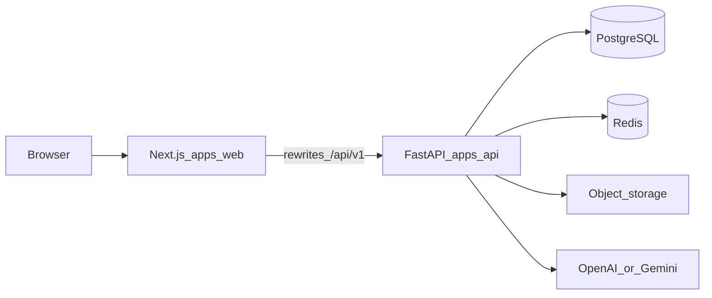
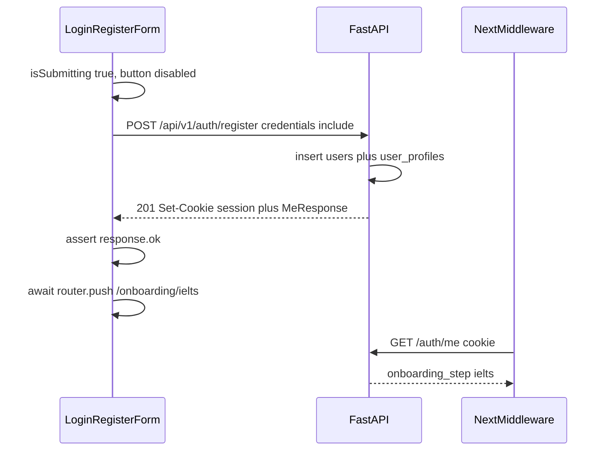

# Architecture: IELTS + Digital SAT Platform

Согласовано с [`docs/PRD.md`](PRD.md), [`prisma/schema.prisma`](../prisma/schema.prisma), [`docs/openapi.yaml`](openapi.yaml).  
Имена таблиц, полей, enum’ов и путей API — английские.

---

## 1. Контекст (C4)

| Компонент | Назначение |
|---|---|
| `apps/web` | Next.js 15 App Router, Tailwind, RHF + Zod, middleware-гейт |
| `apps/api` | FastAPI, SQLAlchemy 2.0, Pydantic v2, JWT в cookie |
| PostgreSQL | Данные 1:1 с Prisma-контрактом |
| Alembic | **Единственный** runtime migration-раннер |
| Redis | Очередь jobs, rate limit, опциональный session denylist |
| Object storage | `listening_cues.audio_url`, Speaking recordings |
| LLM | Writing: 4 criteria; STT — отдельный провайдер/очередь |

`packages/*` на MVP не обязателен.

### Prisma vs Alembic

`prisma/schema.prisma` — контракт схемы (документация, генерация типов).  
Применять миграции в окружениях будет **Alembic**, зеркаля те же таблицы. Два независимых migration-раннера **не используем**. Не вызывать `prisma migrate deploy` в CI/prod.

---

## 2. Auth: cookie session

- Cookie name: **`session`**
- Flags: `HttpOnly; Secure; SameSite=Lax; Path=/`
- Payload JWT (минимально): `sub` (user id), `role`, `exp`
- Источник истины на сервере — cookie + запись `users`. Клиент **не** кладёт JWT в `localStorage` как канон.
- Все mutating-запросы: `credentials: 'include'`.
- Logout: `POST /api/v1/auth/logout` → **204**, `Set-Cookie` с истекшим `session`.

Пароль: Argon2id или bcrypt. Поля `users.email`, `users.username` — unique.

`GET /api/v1/auth/me` возвращает:

- `id`, `email`, `username`, `role`
- `onboarding_completed`
- `onboarding_step`: `ielts` | `sat` | `complete`
- `ielts_onboarding_at`, `sat_onboarding_at`

Правило `onboarding_step`:

1. нет `ielts_onboarding_at` → `ielts`
2. есть IELTS, нет `sat_onboarding_at` → `sat`
3. иначе → `complete` (и `onboarding_completed=true` выставляет только `POST /onboarding/sat`)

---

## 3. Anti-bug: auth и редиректы (жёсткий гайд)

### 3.1 Submit

1. Кнопка `disabled={isSubmitting}` (RHF).
2. Игнорировать повторный submit, пока промис не settled.
3. `AbortController` на unmount формы, чтобы не делать `navigate` после размонтирования.

### 3.2 Register: 201 vs 409

Сервер:

1. Валидация тела → **422** (`validation_error`), никогда не 409.
2. Lookup unique `email` / `username` (опциональный pre-check).
3. `INSERT`; `IntegrityError` / unique violation → **409** с `ConflictError.field` = `email` | `username`.
4. Любая другая ошибка → **400** / **500**, **не** 409.

Клиент показывает 409 у конкретного поля. Не трактовать 5xx как «логин занят».

### 3.3 Cookie строго до `navigate()`

Последовательность register (то же для login с 200):

Запрещено:

- `router.push` до `await fetch(...)` и проверки `response.ok`
- `navigate()` параллельно с запросом
- считать сессию установленной по телу JSON без cookie (`credentials` забыты → пользователь «залогинен» в памяти и 401 на следующем запросе)

После **register** всегда `/onboarding/ielts`, **не** `/dashboard`.  
После **login** — маршрут по `onboarding_step` из тела 200.

### 3.4 Middleware web

Читает cookie `session` (не body). При валидной сессии:

- защищённые учебные маршруты требуют `onboarding_step=complete` иначе редирект на шаг;
- `/onboarding/sat` без `ielts_onboarding_at` → `/onboarding/ielts`;
- `/login` при complete → `/dashboard`.

Доверять только серверу: middleware может декодировать JWT, но флаги онбординга лучше подтверждать `/me` или claims, которые API обновляет только после успешных POST онбординга.

### 3.5 Идемпотентность

Unique на `email` и `username`. Клиентский `Idempotency-Key` опционален. Повтор 201-запроса с тем же email → **409**, не второй пользователь.

---

## 4. Онбординг (серверные инварианты)

Маппинг JSON → колонки `user_profiles` (имена API короче префикса таблицы):

| API | Колонка |
|---|---|
| `current_band` / `current_unknown` | `ielts_current_band` / `ielts_current_unknown` |
| `target_band` | `ielts_target_band` |
| `previous_band` | `ielts_previous` |
| `planned_date` / `planned_year` / `planned_month` / `date_precision` | `ielts_planned_*` / `ielts_date_precision` |
| SAT `current_score` / `current_unknown` / `target_score` / `sat_target_is_plus` | `sat_current_*` / `sat_target_*` |
| `previous_score` | `sat_previous` |
| `sat_session_id` | `sat_session_id` |

`POST /api/v1/onboarding/ielts`

- Пишет `user_profiles` IELTS-поля и `ielts_onboarding_at=now()`.
- `current_unknown=true` ⇔ `ielts_current_band` IS NULL; оба заданы или оба пусты при `unknown=false` → **422**.
- `target_band` ∈ `6.0, 6.5, 7.0, 7.5, 8.0, 8.5+`.
- `date_precision=day` требует `planned_date`; `month` требует `ielts_planned_year` + `ielts_planned_month` (1–12).

`POST /api/v1/onboarding/sat`

- Если `ielts_onboarding_at` IS NULL → **403**.
- `sat_session_id` должен существовать в `sat_official_sessions` и `is_published=true`; месяц только `SatMonth`.
- `sat_target_is_plus=true` только вместе с `target_score=1500` (пресет 1500+); свободный балл может быть любым 400–1600 шаг 10.
- Успех: `sat_onboarding_at=now()`, `onboarding_completed=true`.

`GET /api/v1/sat/official-dates` — публичный список published-сессий (query `include_past`).

---

## 5. RBAC

Зависимость FastAPI: `require_roles(*roles)`.

| Возможность | `admin` | `content_manager` | `moderator` | `student` |
|---|---|---|---|---|
| `GET /admin/dashboard-stats` | да | агрегат | агрегат | 403 |
| `POST /admin/tests/create` | да | да | 403 (read-only UI) | 403 |
| Users adjust/reset | да + `audit_logs` | 403 | view only | 403 |
| SAT calendar write | да | да | 403 | 403 |
| `PATCH /admin/writing/{id}/override` | да | 403 | да | 403 |
| Практика / dashboard / flashcards | да* | да* | да* | да |

\* Сотрудники с завершённым онбордингом.

Ручные правки баллов и сброс прогресса: `audit_logs.action` = `adjust_score` | `reset_progress`; HITL — `override_writing`. Поля: `actor_id`, `target_user_id`, `entity_type`, `entity_id`, `before`/`after` JSON, `ip`.

Web-маршруты `/admin/*` закрыты middleware по `role`. Не полагаться только на скрытие кнопок.

---

## 6. Практика, таймер, адаптив

`user_attempts.status`: `in_progress` → `submitted` → `scored` (или `abandoned`).

**Timer integrity:** дедлайн = `started_at + exam_sections.duration_sec`. Ответы после дедлайна — **403**. Клиентский таймер косметический.

**Listening:** плеер стартует autoplay; вопросы фильтруются по `questions.audio_cue_id` → `listening_cues.start_ms/end_ms`.

**SAT adaptive:** после Module 1 API считает промежуточный результат и выбирает сложность M2; путь пишется в `adaptive_path` JSON, `module_index` 1 затем 2.

**Grid-in vs MCQ:** `question_type` = `grid_in` | `mcq`; `correct_answer` JSON.

**Desmos-like:** iframe на фронте; API не считает выражения калькулятора.

---

## 7. AI pipeline

### Writing (MVP синхронный черновик)

1. Submit writing attempt → строка `ai_writing_evaluations` со `status=ai_pending`.
2. Вызов OpenAI/Gemini: четыре балла `ai_task_achievement`, `ai_coherence`, `ai_lexical`, `ai_grammar`, `ai_overall` + `ai_feedback` JSON.
3. `status=ai_done`.
4. HITL: `PATCH .../override` заполняет `human_override_*`, `reviewer_id`, `reviewed_at`, `status=human_review|final`, audit.

Провайдер выбирается env (`OPENAI_API_KEY` / `GEMINI_API_KEY`); промпт версионируется в коде API, не в БД на MVP.

### Speaking (очередь Redis)

Загрузка аудио в object storage → job `stt:{evaluation_or_attempt_id}` в Redis (RQ/Celery). Worker пишет транскрипт. Полноценный fluency scoring — вне MVP.

---

## 8. Redis keys (конвенция)

| Ключ | TTL | Назначение |
|---|---|---|
| `rl:auth:{ip}` | 15m | Rate limit login/register |
| `sess:deny:{jti}` | = exp JWT | Logout denylist (если используем jti) |
| `job:stt:{id}` | до ack | STT payload / статус |
| `job:writing:{id}` | до ack | Опциональная async-догрузка Writing |

Не хранить PII эссе в ключе Redis дольше, чем нужно worker’у; канон — PostgreSQL `ai_writing_evaluations`.

---

## 9. Файловое хранилище

- Listening: админ загружает файл → URL в `listening_cues.audio_url` (HTTPS object storage).
- Speaking: приватные объекты, signed GET только владельцу и staff.
- Имена объектов: `listening/{exam_section_id}/{cue_id}.mp3`, `speaking/{user_id}/{attempt_id}.webm`.

---

## 10. Слой данных

Индексы и unique — в Prisma. Alembic-модели SQLAlchemy обязаны повторить:

- `users.email`, `users.username` unique + indexes
- `user_flashcards_progress` unique `(user_id, flashcard_id)`, index `(user_id, next_review)`
- `sat_official_sessions` unique `(year, month)`
- `user_answers` unique `(attempt_id, question_id)`

JSON-поля: `questions.content|options|correct_answer`, `user_answers.answer`, `user_attempts.adaptive_path`, `ai_writing_evaluations.ai_feedback`, `audit_logs.before|after`.

---

## 11. Чеклист приёмки auth (QA)

- [ ] Login — форма по умолчанию; toggle «Создать аккаунт» не ломает URL-контракт `/login?mode=register`.
- [ ] Submit disabled при `isSubmitting`.
- [ ] Register 201, cookie в DevTools до смены маршрута.
- [ ] Двойной клик не создаёт двух пользователей.
- [ ] Существующий email/username → 409 и только 409 для этого случая.
- [ ] Короткий пароль → 422.
- [ ] После register URL = `/onboarding/ielts`.
- [ ] Прямой заход на `/onboarding/sat` без IELTS → редирект или 403 API.
- [ ] SAT дата — только published official sessions.
- [ ] Logout 204, повторный `/me` → 401.
- [ ] Student не открывает `/admin/*` (UI + 403 API).

---

## 12. Соответствие спринтам

W1: каркас, auth cookie-before-navigate, онбординг, seed `sat_official_sessions`.  
W2: dashboard, Reading, Listening, SAT RW MCQ.  
W3: Writing+LLM, SM-2, Test Builder.  
W4: Math+Desmos, adaptive, admin users/calendar/analytics, HITL.
