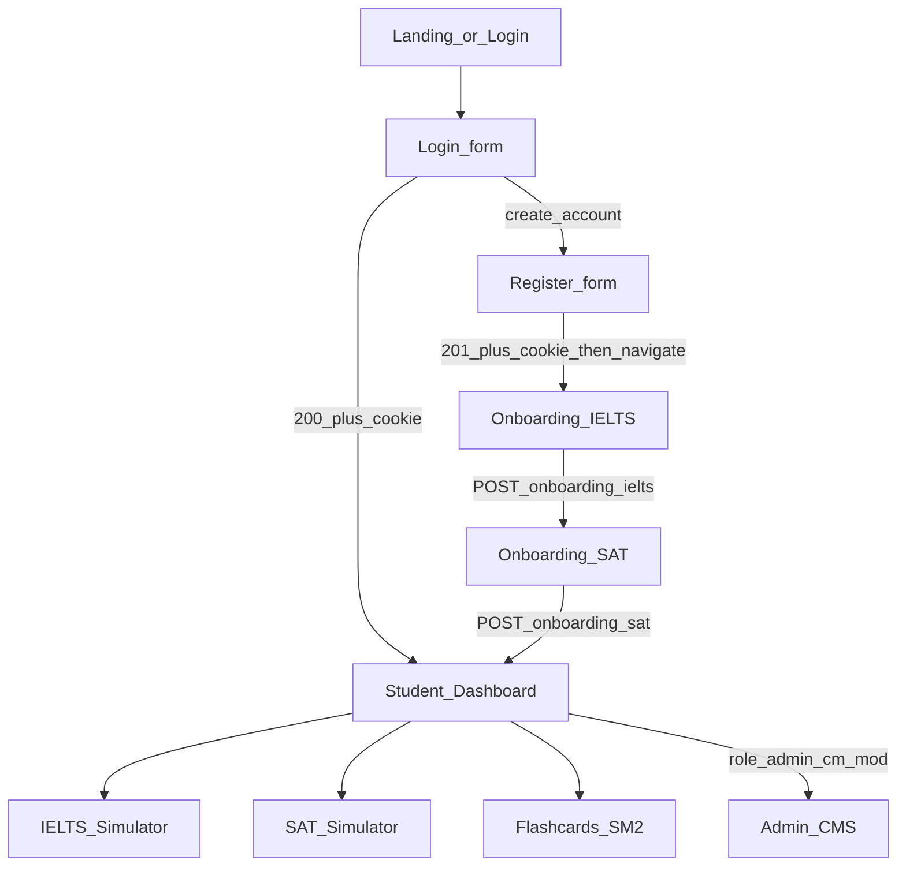

# PRD: платформа IELTS + Digital SAT

Документ описывает продукт, экраны, пользовательский поток и roadmap MVP.  
Каноническая схема БД — [`prisma/schema.prisma`](../prisma/schema.prisma).  
Контракт HTTP — [`docs/openapi.yaml`](openapi.yaml).  
Технический гайд по auth/редиректам — [`docs/ARCHITECTURE.md`](ARCHITECTURE.md).

Идентификаторы полей, enum’ы, пути API и SQL — на английском, как в Prisma/OpenAPI.

---

## 1. Продукт и цели

Образовательная веб-платформа для подготовки к **IELTS** и **Digital SAT** в одном аккаунте.

- Студент регистрируется, проходит онбординг **строго IELTS → SAT**, видит дашборд с обратным отсчётом и прогрессом, тренируется в симуляторах и по карточкам SM-2.
- Контент-роль собирает тесты (WYSIWYG, аудио с таймкодами, LaTeX, ключи/подсказки).
- Админ и модератор управляют пользователями, календарём SAT и очередью HITL по Writing.

**Вне MVP:** полноценный scoring Speaking, платежи, нативные мобильные приложения.

### Персоны

| Персона | `UserRole` | Цель |
|---|---|---|
| Студент | `student` | Закрыть разрыв current → target к выбранной дате экзамена |
| Администратор | `admin` | Полный контроль: контент, пользователи, баллы, календарь, аналитика, HITL |
| Контент-менеджер | `content_manager` | Test Builder, SAT-календарь, агрегированная аналитика |
| Модератор | `moderator` | Просмотр тестов и пользователей, HITL override эссе, агрегированная аналитика |

---

## 2. Архитектурный обзор (продуктовый)

Целевой монорепозиторий (код приложения — следующие спринты):

| Путь | Стек |
|---|---|
| `apps/web` | Next.js App Router, Tailwind, React Hook Form + Zod, middleware онбординга |
| `apps/api` | FastAPI, SQLAlchemy 2.0, **Alembic** (единственный migration-раннер) |
| PostgreSQL | таблицы 1:1 с Prisma-контрактом |
| Redis | сессии/рейтлимит, очередь AI (Speaking STT; Writing draft синхронно на MVP) |
| Object storage | аудио Listening/Speaking |
| LLM | OpenAI / Gemini — 4 критерия IELTS Writing |

Prisma-схема — контракт для фронта и документации. **Не** запускать Prisma Migrate параллельно с Alembic.

Сессия: cookie `session` (HttpOnly, Secure, SameSite=Lax). JWT в `localStorage` не является источником истины.

---

## 3. User flow

### Правила маршрутизации (web middleware + `GET /api/v1/auth/me`)

| Состояние | `onboarding_step` | Редирект |
|---|---|---|
| Нет cookie | — | `/login` |
| Cookie, нет `ielts_onboarding_at` | `ielts` | `/onboarding/ielts` |
| Есть IELTS, нет `sat_onboarding_at` | `sat` | `/onboarding/sat` |
| `onboarding_completed=true` | `complete` | `/dashboard` (и практика) |
| `role` ∈ admin / content_manager / moderator | `complete`* | доступен `/admin/*` |

\* Сотрудники тоже проходят онбординг либо сидируются с `onboarding_completed=true`.

Логин уже онборженного студента: `200` + cookie → `/dashboard` (не онбординг).  
Регистрация: **всегда** `/onboarding/ielts`, никогда сразу дашборд.

---

## 4. Экраны UI

Базовый URL-контракт фронта:

| Маршрут | Экран |
|---|---|
| `/login` | Вход (по умолчанию) |
| `/login?mode=register` | Регистрация (toggle + deep-link) |
| `/onboarding/ielts` | Шаг 1 |
| `/onboarding/sat` | Шаг 2 |
| `/dashboard` | Дашборд студента |
| `/practice/ielts/listening` | Listening |
| `/practice/ielts/reading` | Reading |
| `/practice/ielts/writing` | Writing T1/T2 |
| `/practice/ielts/speaking` | Speaking |
| `/practice/sat` | Digital SAT (RW + Math) |
| `/flashcards` | SM-2 |
| `/admin/tests` | Test Builder |
| `/admin/users` | Пользователи |
| `/admin/sessions` | Календарь SAT |
| `/admin/analytics` | Аналитика |
| `/admin/writing-queue` | HITL Writing |

### 4.1 Auth: Login / Register

**По умолчанию** форма входа. Поля: `login` (email или `username`) + `password`.  
Toggle «Создать аккаунт» переключает на регистрацию **без смены pathname** (остаётся `/login`) или с query `?mode=register` для deep-link.

Поля регистрации: `email`, `username`, `password`.

**Состояния кнопки Submit**

- `disabled={isSubmitting}` (RHF).
- Повторный submit игнорируется, пока запрос в полёте.
- На unmount — `AbortController`.

**Успех**

- Register: HTTP **201 Created** + `Set-Cookie: session` в том же ответе → затем `await router.push('/onboarding/ielts')`.  
  **Запрещено** вызывать `navigate()` / `router.push` до подтверждения `response.ok` при `credentials: 'include'`.
- Login: HTTP **200** + cookie → если `onboarding_step=complete` то `/dashboard`, иначе соответствующий шаг онбординга.

**Ошибки (не маскировать)**

| HTTP | Когда | UI |
|---|---|---|
| **409 Conflict** | **Только** если `email` или `username` уже существуют (`ConflictError.field` = `email` \| `username`) | Сообщение у поля |
| 422 | Валидация Zod/Pydantic | Подсветка полей |
| 401 | Неверный пароль/логин | Общий баннер (login) |
| 5xx | Сбой сервера | Общий баннер, **не** 409 |

### 4.2 Онбординг IELTS (`POST /api/v1/onboarding/ielts`)

Порядок обязателен на сервере: SAT до IELTS → **403**.

| Поле API | UI | Правила |
|---|---|---|
| `current_unknown` | «Не знаю текущий балл» | Если true — `current_band` = null |
| `current_band` | Слайдер/селект 1.0–9.0 шаг 0.5 | Обязателен если не unknown |
| `target_band` | Только `6.0` / `6.5` / `7.0` / `7.5` / `8.0` / `8.5+` | Enum `IeltsTargetBand` |
| `previous_band` | Прошлый официальный результат | Опционально, 1.0–9.0 шаг 0.5 |
| `date_precision` | Переключатель «день» / «месяц и год» | `day` \| `month` |
| `planned_date` | Date picker | Обязателен при `day` |
| `planned_year`, `planned_month` | Месяц + год | Обязательны при `month` |

После **200** — переход на `/onboarding/sat`.

### 4.3 Онбординг SAT (`POST /api/v1/onboarding/sat`)

| Поле API | UI | Правила |
|---|---|---|
| `current_unknown` | «Не знаю» | Если true — `current_score` = null |
| `current_score` | 400–1600 шаг 10 | Обязателен если не unknown |
| `target_score` | Пресеты **1200 / 1350 / 1500+** + свободный ввод 400–1600 шаг 10 | `1500+` → `target_score=1500`, `sat_target_is_plus=true` |
| `previous_score` | Прошлый результат | Опционально |
| `sat_session_id` | Список из `GET /api/v1/sat/official-dates` | **Только** опубликованные сессии College Board: месяцы `mar, may, jun, aug, oct, nov, dec` |

Свободный календарь и месяцы Jan/Feb/Apr/Sep **запрещены**.

После **200** (`onboarding_completed=true`) — `/dashboard`.

### 4.4 Dashboard (`GET /api/v1/dashboard`)

Виджеты:

1. **Countdown IELTS** — дни до `ielts_planned_date` (для `month` — до 1-го числа месяца) или «дата не задана».
2. **Countdown SAT** — дни до `sat_official_sessions.start_date` выбранной сессии.
3. **Progress IELTS** — current → `target_band` (unknown: показать только цель).
4. **Progress SAT** — current → `target_score` (с суффиксом «+», если `sat_target_is_plus`).
5. **CTA** — практика IELTS / SAT, рекомендации, due-карточки (`flashcards_due_count`).
6. Ссылка в админку, если роль не `student`.

`403`, если онбординг не завершён (middleware не должен пускать на `/dashboard`).

### 4.5 Модули практики

#### IELTS Listening

- HTML5 audio, **autoplay при старте** попытки (с fallback, если браузер блокирует).
- Таймер секции `exam_sections.duration_sec`.
- Вопросы привязаны к `listening_cues` (`start_ms`, `end_ms`, `audio_url`).
- По истечении таймера — авто-submit секции.

#### IELTS Reading

- Split pane: пассаж слева, вопросы справа.
- Синхронный скролл якорей, если в `content` заданы маркеры.

#### IELTS Writing (Task 1 / Task 2)

- Текстовый редактор, лимит слов как ориентир.
- После submit — синхронный черновик оценки LLM по 4 критериям: Task Achievement / Coherence / Lexical / Grammar (`ai_*` в `ai_writing_evaluations`).
- Статус `ai_pending` → `ai_done`; эссе попадает в HITL-очередь (`human_review` / `final`).

#### IELTS Speaking

- `MediaRecorder` → object storage.
- STT через очередь Redis (асинхронно). Полноценный scoring fluency/vocab — **вне MVP**; на MVP — запись + транскрипт.

#### Digital SAT

- Адаптив: Module 1 → Module 2 (`module_index` 1|2, `adaptive_path` JSON).
- RW и Math: **MCQ** + **grid-in**.
- Math: iframe калькулятора в стиле Desmos.
- W2: SAT Math grid-in без адаптивности можно отгрузить раньше; полный M1→M2 — W4.

#### Flashcards (SM-2)

Поля прогресса: `ease_factor`, `interval_days`, `repetition`, `next_review`, `last_quality` (0–5).  
Уникальность `(user_id, flashcard_id)`.

---

## 5. Схема данных (ссылка)

Полный DDL-контракт: [`prisma/schema.prisma`](../prisma/schema.prisma).

Обязательные таблицы ТЗ и расширения плана:

`users`, `user_profiles`, `exams`, `exam_sections`, `questions`, `user_attempts`, `user_answers`, `flashcards`, `user_flashcards_progress`, `ai_writing_evaluations`, плюс `username` и `role` на users, `sat_official_sessions`, `listening_cues`, HITL-поля, `audit_logs`.

Ключевые enum’ы (совпадают с OpenAPI):

- `UserRole`: `student` | `admin` | `content_manager` | `moderator`
- `IeltsTargetBand` (DB `@map`): `6.0` | `6.5` | `7.0` | `7.5` | `8.0` | `8.5+`
- `DatePrecision`: `day` | `month`
- `SatMonth`: `mar` | `may` | `jun` | `aug` | `oct` | `nov` | `dec`
- `AiWritingEvalStatus`: `ai_pending` | `ai_done` | `human_review` | `final`
- `AttemptStatus`: `in_progress` | `submitted` | `scored` | `abandoned`

Индексы: `users.email`, `users.username`, `user_flashcards_progress.next_review`, unique `(user_id, flashcard_id)`, unique `(year, month)` на сессиях SAT.

---

## 6. Admin / CMS UX

Префикс API: `/api/v1/admin/*` + `require_roles(...)`.

| Возможность | Admin | Content Manager | Moderator |
|---|---|---|---|
| Test Builder (WYSIWYG, audio+timecodes, LaTeX, answers/hints/explanations) | да | да | только чтение |
| Users: просмотр / корректировка баллов / сброс прогресса | да | нет | только просмотр |
| SAT calendar + deadlines | да | да | нет |
| Analytics | да | агрегат | агрегат |
| HITL essay override | да | нет | да |

### `/admin/tests`

- Создание через `POST /api/v1/admin/tests/create` (**201**): exam + sections (`module_index`, `duration_sec`, `sort_order`) + `listening_cues` + questions (`content`/`options`/`correct_answer` JSON, `has_latex`, `hint`, `explanation`, связь cue через `audio_cue_client_key`).
- Модератор видит список и превью, кнопки записи скрыты (API **403**).

### `/admin/users`

- Поиск, профиль, попытки.
- Adjust score / reset progress — только admin; каждая операция пишет `audit_logs` (`adjust_score` | `reset_progress`).

### `/admin/sessions`

- CRUD публикаций `sat_official_sessions` (`is_published`, `start_date`, `registration_deadline`).
- Онбординг студентов читает только `is_published=true`.

### `/admin/analytics`

- `GET /api/v1/admin/dashboard-stats`: `users_total`, `users_onboarded`, `attempts_today`, `writing_queue_pending`, `exams_published`.

### `/admin/writing-queue`

- `PATCH /api/v1/admin/writing/{evaluation_id}/override` — поля `human_override_*`, `reviewer_id`, `status` ∈ `human_review` | `final`.

---

## 7. API (поверхности продукта)

Полные схемы и коды — OpenAPI. Минимум:

| Метод | Путь | Успех | Ошибки |
|---|---|---|---|
| POST | `/api/v1/auth/register` | **201** | **409** unique, **422** |
| POST | `/api/v1/auth/login` | **200** | **401**, **422** |
| POST | `/api/v1/auth/logout` | **204** | **401** |
| GET | `/api/v1/auth/me` | **200** | **401** |
| POST | `/api/v1/onboarding/ielts` | **200** | **401**, **422** |
| POST | `/api/v1/onboarding/sat` | **200** | **401**, **403**, **422** |
| GET | `/api/v1/sat/official-dates` | **200** | — |
| GET | `/api/v1/dashboard` | **200** | **401**, **403** |
| POST/GET | `/api/v1/attempts` … | **201**/**200** | **401**, **403**, **404**, **422** |
| GET/POST | `/api/v1/flashcards/due`, `.../review` | **200** | **401**, **403**, **404**, **422** |
| GET | `/api/v1/admin/dashboard-stats` | **200** | **401**, **403** |
| POST | `/api/v1/admin/tests/create` | **201** | **401**, **403**, **422** |
| PATCH | `/api/v1/admin/writing/{id}/override` | **200** | **401**, **403**, **404**, **422** |

---

## 8. Anti-bug (кратко для продукта)

Детальный чеклист — Architecture. Обязательно для приёмки auth:

1. Submit disabled на время запроса.
2. 409 **только** на существующий email/username.
3. Cookie в том же ответе, что 201; `navigate()` строго после успеха.
4. Не использовать `localStorage` JWT как истину.
5. После register — только `/onboarding/ielts`.
6. Middleware читает cookie; `/me` отдаёт `onboarding_step`.

---

## 9. NFR

- **a11y:** фокус в формах, подписи полей, контраст, клавиатура в MCQ.
- **Timer integrity:** таймер Listening/SAT считается server-side (`started_at` + `duration_sec`); клиентский таймер — UX, не источник истины.
- **Безопасность:** httpOnly cookie, bcrypt/argon2, RBAC на каждом admin-роуте, audit на ручные правки.
- **Идемпотентность регистрации:** unique email/username; опциональный `Idempotency-Key` на клиенте.

---

## 10. MVP roadmap (4 спринта × 1 неделя)

### Week 1 — фундамент и онбординг

Монорепо skeleton (`apps/web`, `apps/api`), таблицы `users` / `user_profiles` / `sat_official_sessions`, auth **201/409**, cookie-before-navigate, онбординг IELTS→SAT, seed официальных SAT-дат.

### Week 2 — дашборд и первые симуляторы

Dashboard (countdown + progress + CTA). IELTS Reading split pane, Listening player (таймер + autoplay). SAT RW **MCQ без adaptive**.

### Week 3 — Writing, карточки, Test Builder

IELTS Writing + GPT-4o (4 criteria), очередь HITL-статусов. Flashcards SM-2. Admin Test Builder v1 (WYSIWYG, ключи).

### Week 4 — Math, адаптив, админ-операции

SAT Math grid-in + Desmos iframe. Adaptive M1→M2. Admin users / calendar / analytics. HITL writing queue + override.

**Готовность MVP:** студент проходит register → IELTS → SAT → dashboard → хотя бы один полный IELTS-модуль и SAT RW+Math; админ публикует тест и правит эссе.
